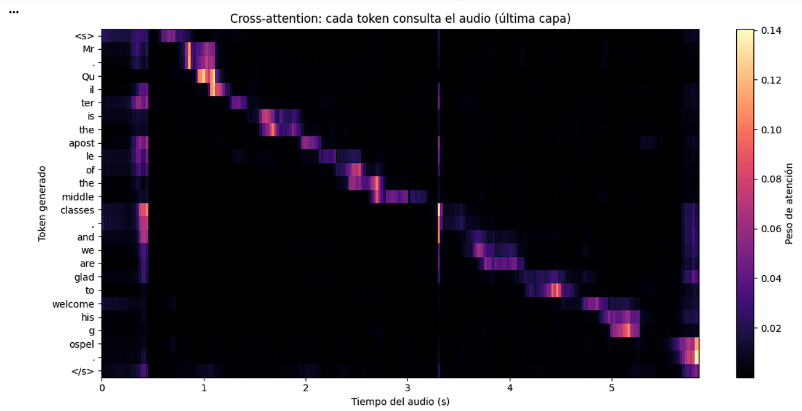
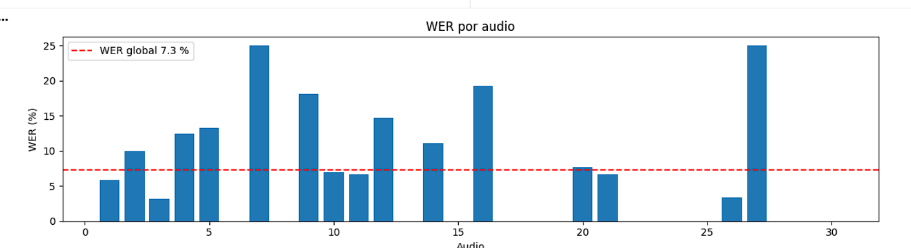
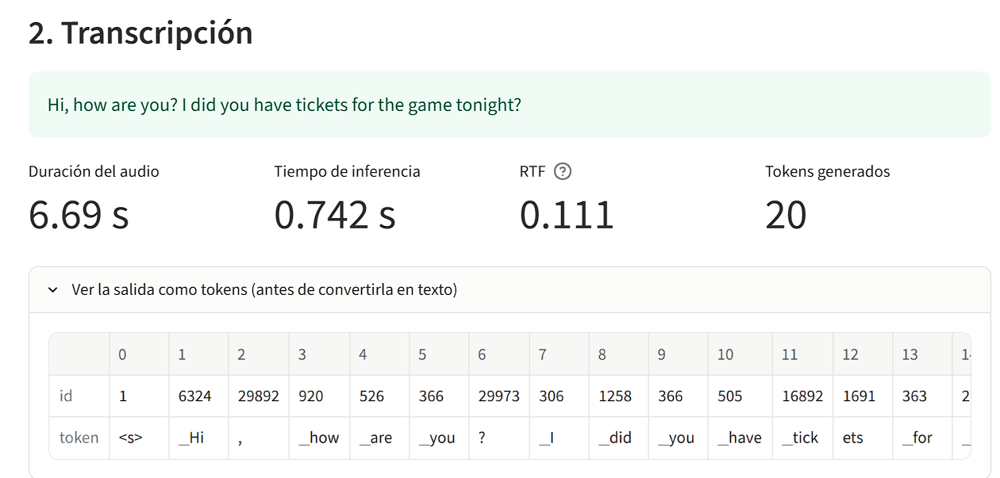
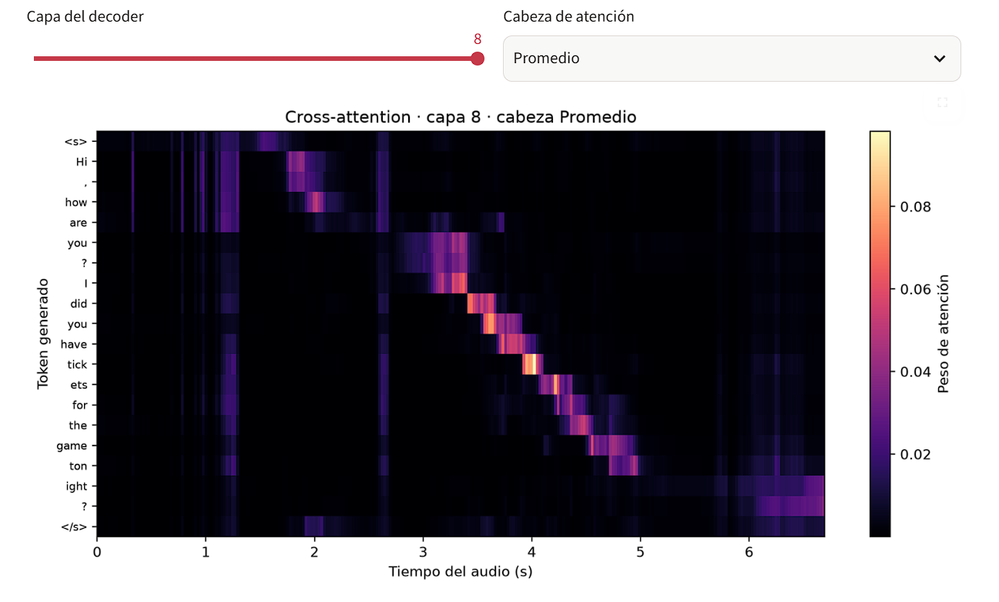
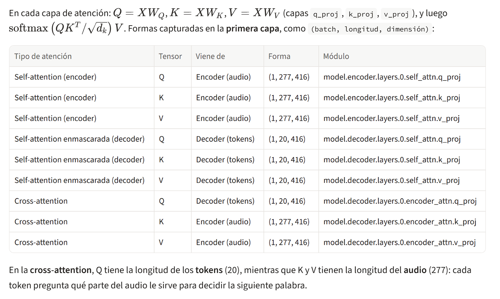

# Moonshine: reconocimiento de voz con un Transformer encoder–decoder

**Proyecto final · Procesamiento de Datos Secuenciales con Deep Learning**
**Autora:** Heidy Romero Ayos · **Profesora:** Nataly Velandia · Noviembre de 2026

---

## 1. Resumen (Abstract)

Este proyecto implementa el proceso de **inferencia** de **Moonshine**, una familia de modelos de reconocimiento automático de voz (ASR) basada en un **Transformer encoder–decoder**, usando sus pesos preentrenados. El encoder procesa la señal de audio cruda y el decoder genera la transcripción token por token mediante **cross-attention**. Además de transcribir, el proyecto analiza el modelo por dentro: la creación de los tensores **Q, K y V**, y los mapas de atención del encoder, del decoder (con máscara causal) y de la cross-attention, que muestran cómo el modelo alinea cada palabra con un fragmento del audio.

Se desarrolló un notebook de análisis y una **aplicación interactiva en Streamlit** que permite subir o grabar un audio y observar la inferencia. En una muestra de LibriSpeech, el modelo **Moonshine Base** obtuvo un **WER de X,XX %** y un **RTF de 0,064** en GPU (unas 15 veces más rápido que el tiempo real), frente al WER de 3,23 % que reporta el artículo sobre el conjunto completo *test-clean*. En un computador personal **sin GPU**, la app transcribió una nota de voz con un **RTF de 0,111** (unas 9 veces más rápido que el tiempo real). Una prueba con un **hablante no nativo** (francófono) mostró que el modelo entiende casi toda la frase, pero es sensible al acento.

---

## 2. Introducción

**Artículo base:** N. Jeffries, E. King, M. Kudlur, G. Nicholson, J. Wang y P. Warden, *"Moonshine: Speech Recognition for Live Transcription and Voice Commands"*, arXiv:2410.15608, 2024. [[artículo]](https://arxiv.org/abs/2410.15608)

**Repositorio original:** https://github.com/usefulsensors/moonshine
**Pesos preentrenados:** https://huggingface.co/UsefulSensors/moonshine-base

**Contexto del problema.** El reconocimiento de voz en tiempo real es clave para subtítulos en vivo, herramientas de accesibilidad para personas con discapacidad auditiva y comandos de voz en dispositivos pequeños. Estas aplicaciones suelen correr en hardware de bajo costo y sin conexión a internet, donde la **latencia** es crítica.

**Motivación.** Whisper (OpenAI), el modelo de referencia, procesa siempre bloques de **30 segundos**: si el audio es más corto, lo rellena con ceros. Por eso gasta el mismo cómputo en un audio de 2 segundos que en uno de 30. Los autores de Moonshine midieron que, incluso con el modelo más pequeño de Whisper, la latencia mínima era de unos 500 ms, demasiado para una experiencia fluida.

**Objetivo.** Implementar la inferencia de Moonshine con pesos preentrenados, explicar en detalle su arquitectura encoder–decoder y su mecanismo de atención, y demostrar su funcionamiento con una interfaz interactiva y métricas propias.

---

## 3. Marco teórico

### 3.1 Arquitectura general

Moonshine es un **Transformer encoder–decoder** (Vaswani et al., 2017) para la tarea **audio → texto**:

```
Audio crudo (16 kHz)
   │
   ▼
Stem convolucional (3 Conv1D)  ──►  secuencia de vectores de audio   ← "embedding" del audio
   │
   ▼
ENCODER  ×N  [ self-attention + RoPE → feed-forward (GELU) ]
   │                                   (K y V para la cross-attention)
   ▼                                              │
DECODER  ×N  [ self-attention enmascarada + RoPE → cross-attention ◄─┘ → feed-forward (SwiGLU) ]
   │
   ▼
Capa lineal + softmax  ──►  siguiente token  ──►  (se repite token por token)
```

| Parte | Detalle |
|---|---|
| **Entrada** | Forma de onda cruda a 16 kHz, **sin espectrograma mel** |
| **Stem convolucional** | Conv1D kernel 127 / stride 64 → tanh; Conv1D kernel 7 / stride 3 → GELU; Conv1D kernel 3 / stride 2 → GELU. Comprime el audio **384×** (≈ 41,7 vectores por segundo). Es análogo al *patch embedding* del Vision Transformer |
| **Encoder** | Self-attention multi-head + RoPE + feed-forward con GELU |
| **Decoder** | Self-attention enmascarada + RoPE, cross-attention al encoder y feed-forward con SwiGLU |
| **Tokenizador** | BPE de LLaMA: 32.000 tokens + 768 especiales |
| **Salida** | Capa lineal + softmax sobre el vocabulario; generación **autorregresiva** |

| | Moonshine Tiny | Whisper tiny.en | **Moonshine Base** | Whisper base.en |
|---|---|---|---|---|
| Dimensión | 288 | 384 | **416** | 512 |
| Capas encoder / decoder | 6 / 6 | 4 / 4 | **8 / 8** | 6 / 6 |
| Cabezas de atención | 8 | 6 | **8** | 8 |
| Parámetros | 27,1 M | 37,8 M | **61,5 M** | 72,6 M |

*Fuente: Tabla 1 del artículo.*

### 3.2 Mecanismo de atención

Cada capa de atención usa **Scaled Dot-Product Attention** con varias cabezas (*multi-head*):

$$\text{Atención}(Q,K,V) = \text{softmax}\left(\frac{QK^T}{\sqrt{d_k}}\right)V$$

Los tensores se crean multiplicando la entrada por matrices **aprendidas** (las capas `q_proj`, `k_proj` y `v_proj` del modelo):

$$Q = XW_Q \qquad K = XW_K \qquad V = XW_V$$

La diferencia entre los tres tipos de atención está en **de dónde viene X**:

| Atención | Q viene de… | K y V vienen de… | Función |
|---|---|---|---|
| Self-attention del **encoder** | el audio | el audio | Cada fragmento de audio mira a los demás para construir contexto acústico |
| Self-attention **enmascarada** del decoder | los tokens generados | los tokens generados | Cada token solo mira los anteriores (máscara causal); así aprende a predecir y no a copiar |
| **Cross-attention** | los tokens (decoder) | la salida del **encoder** (audio) | Cada token "pregunta" qué parte del audio necesita para decidir la siguiente palabra |

En la cross-attention, **Q tiene la longitud del texto** y **K y V la longitud del audio**. La matriz de atención resultante muestra el **alineamiento** entre lo que se dice y lo que se escribe.

### 3.3 Innovaciones del modelo

1. **Entrada de longitud variable, sin relleno con ceros.** El cómputo del encoder crece con la duración real del audio. Según el artículo, Moonshine Tiny necesita **5 veces menos cómputo** que Whisper tiny.en para un audio de 10 segundos.
2. **RoPE (Rotary Position Embeddings)** en lugar de posiciones absolutas. La posición se aplica **rotando Q y K**, de modo que la atención depende de la distancia relativa entre tokens. El artículo muestra por qué era necesario: al quitarle el relleno a Whisper, su WER sube de **5,21 % a 107,38 %**, porque sus posiciones absolutas solo funcionan con bloques de 30 segundos exactos.
3. **Audio crudo con convoluciones**, sin calcular un espectrograma mel a mano.
4. **Modelos pequeños** pensados para transcripción en vivo en dispositivos de pocos recursos.

---

## 4. Metodología

- **Enfoque:** solo inferencia con pesos preentrenados (no se entrenó el modelo).
- **Modelo:** `UsefulSensors/moonshine-base` (61,5 M de parámetros); `moonshine-tiny` como alternativa en la app.
- **Herramientas:** Python, PyTorch, Hugging Face `transformers` (clase `MoonshineForConditionalGeneration`), `librosa` (audio), `jiwer` (WER), `matplotlib` (visualización), **Streamlit** (interfaz) y Google Colab con GPU T4 (análisis).
- **Datos de prueba:** muestra de LibriSpeech (audiolibros en inglés con transcripción de referencia) y grabaciones propias.
- **Análisis interno:** se registran *hooks* en `q_proj`, `k_proj` y `v_proj` para capturar los tensores Q, K y V, y se piden las matrices de atención con `output_attentions=True` (implementación `eager`).
- **Métricas:** WER (Word Error Rate) y RTF (Real-Time Factor = tiempo de inferencia ÷ duración del audio).

---

## 5. Desarrollo e implementación

### 5.1 Estructura del repositorio

```
├── README.md
├── requirements.txt
├── app.py                                   # App interactiva en Streamlit
├── notebooks/
│   └── Moonshine_Inferencia_Heidy_Romero.ipynb   # Análisis completo (Colab)
└── imagenes/                                # Capturas propias de las pruebas
```

### 5.2 Cómo ejecutar

**App interactiva (local):**
```bash
python -m venv venv
venv\Scripts\activate          # en Mac/Linux: source venv/bin/activate
pip install -r requirements.txt
streamlit run app.py
```

**Notebook:** abrir `notebooks/Moonshine_Inferencia_Heidy_Romero.ipynb` en Google Colab, activar la GPU y ejecutar todas las celdas.

### 5.3 Carga de los pesos

Los pesos se descargan automáticamente de Hugging Face la primera vez:

```python
from transformers import AutoProcessor, MoonshineForConditionalGeneration

processor = AutoProcessor.from_pretrained("UsefulSensors/moonshine-base")
model = MoonshineForConditionalGeneration.from_pretrained(
    "UsefulSensors/moonshine-base",
    attn_implementation="eager"     # permite obtener las matrices de atención
)
model.eval()
```

### 5.4 Preprocesamiento e inferencia

1. **Carga del audio:** se lee con `librosa`, se convierte a mono y se remuestrea a **16 kHz**.
2. **Preprocesamiento:** el `processor` convierte la forma de onda en el tensor `input_values` de forma `(batch, número de muestras)`, **sin rellenar a 30 segundos**.
3. **Generación:** `model.generate(...)` produce los ids de los tokens de forma autorregresiva. Se limita la longitud a unos **6,5 tokens por segundo** de audio para evitar repeticiones.
4. **Decodificación:** `processor.decode(...)` convierte los ids en texto.
5. **Análisis:** una pasada adicional con `output_attentions=True` entrega las atenciones del encoder, del decoder y de la cross-attention, que se visualizan como mapas de calor.

```python
inputs = processor(audio, sampling_rate=16000, return_tensors="pt")
max_tokens = int(len(audio) / 16000 * 6.5)
ids = model.generate(**inputs, max_length=max_tokens)
texto = processor.decode(ids[0], skip_special_tokens=True)
```

### 5.5 La aplicación interactiva

La app de Streamlit permite **subir un archivo o grabar la voz** y muestra:
- La forma de onda, la transcripción, el tiempo de inferencia, el RTF y los tokens generados (y el WER, si se escribe la transcripción de referencia).
- Pestañas para explorar la **cross-attention**, la **self-attention enmascarada** del decoder y la **self-attention** del encoder, eligiendo capa y cabeza.
- Una tabla con la forma de los tensores **Q, K y V** y de dónde viene cada uno.
- Los hiperparámetros y la estructura completa del modelo.

---

## 6. Resultados y análisis

### 6.1 Ejemplo de transcripción

| | Texto |
|---|---|
| **Referencia** | MISTER QUILTER IS THE APOSTLE OF THE MIDDLE CLASSES AND WE ARE GLAD TO WELCOME HIS GOSPEL |
| **Moonshine Base** | Mr. Quilter is the apostle of the middle classes, and we are glad to welcome his gospel. |

La transcripción es correcta; las diferencias son solo de formato (mayúsculas, puntuación y la abreviatura "Mr.").

### 6.2 Mapa de cross-attention



- **Diagonal:** a medida que el decoder escribe cada palabra, su atención **avanza en el tiempo del audio**. El modelo aprendió solo qué fragmento de audio corresponde a cada palabra.
- **Subpalabras:** el tokenizador BPE parte palabras como "Qu / il / ter" o "g / ospel", y cada pedazo mira un trozo de audio un poco más adelante.
- **Pausa y puntuación:** cerca del segundo 3,3 hay un salto en la diagonal que coincide con una pausa en la voz y con la coma del texto.
- ***Attention sink*:** algunos tokens (como la coma o `</s>`) concentran su atención en una posición fija del inicio cuando no necesitan información específica del audio.

### 6.3 Métricas

| Métrica | Artículo (Moonshine Base) | Nuestra prueba |
|---|---|---|
| WER en LibriSpeech | 3,23 % (*test-clean*, 2.620 audios) | **X,XX %** (30 audios) |
| Velocidad con GPU | Hasta 3× menos latencia que Whisper | **RTF = 0,064** en GPU T4 de Colab (≈ 15× más rápido que el tiempo real) |
| Velocidad sin GPU | — | **RTF = 0,111** en CPU de un computador personal (≈ 9× más rápido que el tiempo real) |



**Análisis:**
- Cerca del **43 %** de los audios se transcribió **sin ningún error**.
- Los valores más altos de WER por audio aparecen en **frases cortas**, donde un solo error pesa mucho en el porcentaje (1 error en 4 palabras = 25 %).
- Nuestro WER es mayor que el del artículo porque la muestra es pequeña y de otra partición, y porque la **normalización del texto** influye ("Mr." vs. "mister").
- El error más interesante fue **"roast beef" → "rose beef"**: dos palabras que suenan casi igual. Es un error **acústico** en el que al modelo le faltó contexto.

### 6.4 Prueba propia con un hablante no nativo

Se probó la app con una **nota de voz de WhatsApp** (formato .ogg, 6,69 s) grabada por un **hablante nativo de francés**, que pronunció correctamente la frase en inglés.

| | Texto |
|---|---|
| **Frase dicha** | Hi, how are you? Did you have tickets for the game tonight? |
| **Moonshine Base** | Hi, how are you? **I did** you have tickets for the game tonight? |

| Métrica | Valor |
|---|---|
| Duración del audio | 6,69 s |
| Tiempo de inferencia (CPU) | 0,742 s |
| RTF | 0,111 |
| Tokens generados | 20 |
| WER | 9,09 % (1 palabra insertada de 11) |

**Análisis:**
- El modelo transcribió correctamente **casi toda la frase**, incluida la puntuación, pero **insertó la palabra "I"** ("I did you have…" en lugar de "Did you have…").
- **Acento no nativo:** Moonshine se entrenó con unas 200.000 horas de audio en inglés, en su mayoría de hablantes nativos. Con un acento francés, algunos sonidos cambian; la pronunciación del inicio de "Did" pudo interpretarse como "I did".
- **Audio comprimido:** las notas de voz de WhatsApp se comprimen para ocupar poco espacio, lo que elimina detalles del sonido.
- **Tamaño del modelo:** con 61,5 M de parámetros, tiene menos capacidad para adaptarse a voces distintas de las vistas en el entrenamiento.
- En la salida como tokens se observa el funcionamiento del decoder: el token especial de inicio **`<s>`**, el símbolo **`▁`** que marca el inicio de cada palabra y palabras partidas en **subpalabras** por el tokenizador BPE (por ejemplo, "tickets" = `▁tick` + `ets`).
- La forma de onda muestra silencio antes de 1,5 s y después de 5 s; la voz se concentra entre 1,5 y 5 s, que es la zona donde la cross-attention enfoca su atención.



### 6.5 Resultados reportados en el artículo

| Dataset | Whisper base.en | **Moonshine Base** |
|---|---|---|
| AMI | 21,13 | **17,79** |
| Earnings22 | **15,09** | 17,65 |
| GigaSpeech | 12,83 | **12,19** |
| LibriSpeech (clean) | 4,25 | **3,23** |
| LibriSpeech (other) | 10,35 | **8,18** |
| SPGISpeech | **4,26** | 5,46 |
| TED-LIUM | **4,87** | 5,22 |
| VoxPopuli | **9,76** | 10,81 |
| **Promedio** | 10,32 | **10,07** |

*WER (%) — Tabla 2 del artículo.* Moonshine Base iguala o supera en promedio a Whisper base.en con menos parámetros (61,5 M frente a 72,6 M).

### 6.6 Capturas de la aplicación

**Mapa de cross-attention en la app:**



**Tensores Q, K y V de la primera capa:**



---

## 7. Conclusiones

**Aprendizajes**
- La **cross-attention** es lo que hace funcionar al Transformer encoder–decoder en tareas multimodales: Q viene del texto y K y V del audio, y su matriz muestra un alineamiento claro entre voz y palabras.
- La **codificación posicional** no es un detalle menor: el cambio a **RoPE** es lo que permite a Moonshine procesar audios de cualquier duración sin perder precisión.
- Un modelo pequeño bien diseñado puede igualar a uno más grande: Moonshine Base tiene un WER promedio similar al de Whisper base.en con menos parámetros y menor latencia.
- El modelo es realmente eficiente: en un computador personal **sin GPU** transcribe unas **9 veces más rápido que el tiempo real**, lo que confirma su orientación a dispositivos de pocos recursos.

**Limitaciones**
- Solo transcribe **inglés**.
- Es sensible a **acentos no nativos**: en nuestra prueba con un hablante francófono insertó una palabra que no se dijo.
- La **compresión del audio** (por ejemplo, notas de voz de WhatsApp) puede afectar la precisión.
- En **audios muy cortos** (menos de 1 segundo) tiende a repetir tokens, y en **audios largos** (más de 30 segundos) aumentan las alucinaciones.
- Con **audio muy bajito** (por debajo de −40 dB) Whisper es más robusto.
- Comete errores por **similitud acústica** cuando falta contexto ("roast beef" → "rose beef").
- Nuestra evaluación usó una muestra pequeña de audios.

**Posibles mejoras**
- Evaluar sobre el conjunto completo de LibriSpeech *test-clean*, con audios ruidosos y con hablantes de distintos acentos.
- Ajustar (*fine-tuning*) el modelo con audios de hablantes no nativos para mejorar su robustez frente a acentos.
- Probar las versiones multilingües de Moonshine publicadas después del artículo.
- Agregar transcripción en tiempo real (por fragmentos) en la app.

---

## 8. Referencias

[1] N. Jeffries, E. King, M. Kudlur, G. Nicholson, J. Wang y P. Warden, "Moonshine: Speech recognition for live transcription and voice commands," *arXiv preprint arXiv:2410.15608*, 2024.

[2] A. Vaswani, N. Shazeer, N. Parmar, J. Uszkoreit, L. Jones, A. N. Gomez, Ł. Kaiser e I. Polosukhin, "Attention is all you need," en *Advances in Neural Information Processing Systems*, vol. 30, 2017, pp. 5998–6008.

[3] A. Radford, J. W. Kim, T. Xu, G. Brockman, C. McLeavey e I. Sutskever, "Robust speech recognition via large-scale weak supervision," *arXiv preprint arXiv:2212.04356*, 2022.

[4] J. Su, Y. Lu, S. Pan, A. Murtadha, B. Wen e Y. Liu, "RoFormer: Enhanced transformer with rotary position embedding," *Neurocomputing*, vol. 568, art. 127063, 2024.

[5] V. Panayotov, G. Chen, D. Povey y S. Khudanpur, "Librispeech: An ASR corpus based on public domain audio books," en *Proc. IEEE ICASSP*, 2015, pp. 5206–5210.

[6] T. Wolf *et al.*, "Transformers: State-of-the-art natural language processing," en *Proc. EMNLP: System Demonstrations*, 2020, pp. 38–45.

[7] V. Srivastav *et al.*, "Open automatic speech recognition leaderboard," Hugging Face, 2023. [En línea]. Disponible: https://huggingface.co/spaces/hf-audio/open_asr_leaderboard

[8] Useful Sensors, "Moonshine," repositorio de GitHub, 2024. [En línea]. Disponible: https://github.com/usefulsensors/moonshine

**Uso de inteligencia artificial:** este trabajo contó con el apoyo de Claude (Anthropic) como herramienta de apoyo para la explicación de conceptos, la estructuración del código y la redacción de la documentación.
